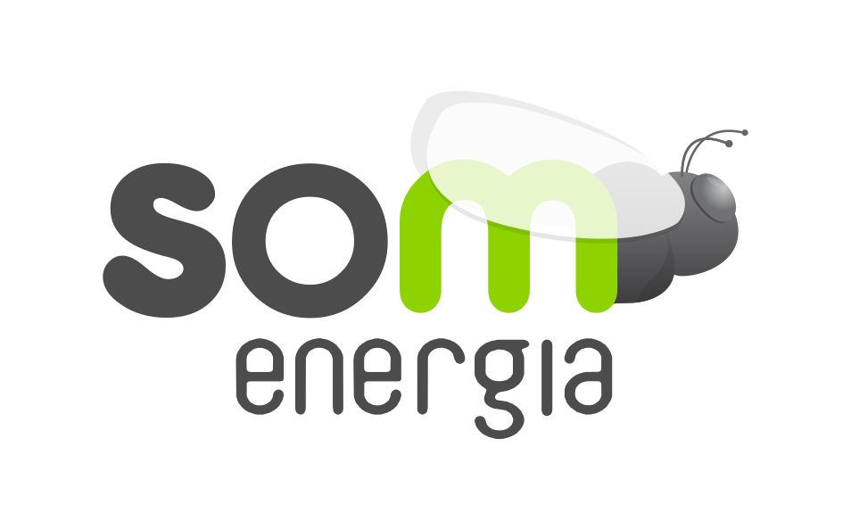

<div class="cover-wrap">
  
  <div class="eyebrow">Formacio interna</div>
  <h1>Programacio agentica</h1>
  <p class="cover-subtitle">SDD, Gentle-IA i OpenCode com a sistema de treball</p>
  <div class="cover-meta">somenergia.coop · 06 / 05 / 2026</div>
</div>

---
layout: default
class: agenda-slide
---

# Index

<div class="agenda-grid">
  <div><span>01</span> No es nomes autocomplete</div>
  <div><span>02</span> Per que el model classic escala malament</div>
  <div><span>03</span> Que vol dir programacio agentica</div>
  <div><span>04</span> Agents, tools, skills, MCP i memoria</div>
  <div><span>05</span> SDD: d'intencio a implementacio</div>
  <div><span>06</span> Gentle-IA: control i qualitat</div>
  <div><span>07</span> OpenCode en un entorn real</div>
  <div><span>08</span> Transicio a la demo</div>
</div>

---
layout: center
class: section-slide
---

<div class="section-number">01</div>

# Aixo no es nomes autocomplete

---
layout: default
---

# El canvi real

## De demanar codi a delegar faena

<div class="two-col">
  <div>
    <p>Ja hem usat LLMs per a:</p>
    <ul>
      <li>autocomplete amb esteroides</li>
      <li>generar funcions</li>
      <li>refactoritzar trossets</li>
    </ul>
  </div>
  <div class="accent-box">
    <p class="big-line">Pero aci el canvi no va d'escriure prompts millors.</p>
    <p class="big-line strong">Va de definir un sistema que treballe per nosaltres.</p>
  </div>
</div>

---
layout: default
---

# El limit del model classic

## Nosaltres continuem sent el scheduler

<div class="card-grid two">
  <div class="card">
    <h3>Model lineal</h3>
    <p><strong>Prompt -&gt; resposta -&gt; iteracio</strong></p>
    <p>Tot depen de la persona que coordina, recorda i reconnecta el context.</p>
  </div>
  <div class="card">
    <h3>Quan es trenca</h3>
    <ul>
      <li>canvis multi-fitxer</li>
      <li>dependencies entre decisions</li>
      <li>context que no cap en un prompt</li>
      <li>iteracions que es perden</li>
    </ul>
  </div>
</div>

<div class="quote-bar">Acabem fent de <strong>copy-paste orchestrator</strong>. I aixo escala malament.</div>

---
layout: center
class: section-slide
---

<div class="section-number">02</div>

# Que vol dir programacio agentica

---
layout: default
---

# Una idea simple

## En lloc d'una crida a un model, definim un sistema

<div class="three-pillars">
  <div class="pillar">
    <div class="pillar-kicker">1</div>
    <h3>Objectiu</h3>
    <p>Que ha d'aconseguir l'agent.</p>
  </div>
  <div class="pillar">
    <div class="pillar-kicker">2</div>
    <h3>Context i memoria</h3>
    <p>Que sap ara i que pot recuperar.</p>
  </div>
  <div class="pillar">
    <div class="pillar-kicker">3</div>
    <h3>Eines</h3>
    <p>Com llig, prova, modifica i verifica.</p>
  </div>
</div>

<div class="quote-bar">La clau es que pot <strong>iterar</strong>: pensa, actua, observa i repeteix.</div>

---
layout: default
class: quote-slide
---

<div class="big-quote">
  <p>"Els enginyers no haurien d'estar escrivint codi...</p>
  <p class="strong">haurien d'estar resolent problemes."</p>
</div>

<p class="quote-source">Model mental per explicar el canvi de paradigma.</p>

---
layout: center
class: section-slide
---

<div class="section-number">03</div>

# Les peces del sistema

---
layout: default
---

# Baixat a terra

## No es magia, es arquitectura de treball

<div class="card-grid two">
  <div class="card">
    <h3>Agents</h3>
    <p>Un loop: <strong>pensa -&gt; actua -&gt; observa -&gt; repeteix</strong>.</p>
  </div>
  <div class="card">
    <h3>Tools</h3>
    <p>Les mans de l'agent: llegir fitxers, executar tests, modificar codi, parlar amb APIs.</p>
  </div>
  <div class="card">
    <h3>Skills</h3>
    <p>Comportaments reutilitzables. No sols funcions: <strong>criteri empaquetat</strong>.</p>
  </div>
  <div class="card">
    <h3>MCP</h3>
    <p>La capa estandard per connectar agents amb sistemes externs.</p>
  </div>
</div>

---
layout: default
---

# Memoria

## Sense memoria, cada pas es amnesia

<div class="card-grid two memory-grid">
  <div class="card">
    <h3>Context</h3>
    <p>Memoria volatil.</p>
    <ul>
      <li>conversa actual</li>
      <li>estat del problema</li>
      <li>ultims resultats</li>
    </ul>
    <p class="muted">Es limitada i es perd.</p>
  </div>
  <div class="card">
    <h3>Memoria persistent</h3>
    <p>Normalment en fitxers o artefactes dins del repo.</p>
    <ul>
      <li>decisions d'arquitectura</li>
      <li>convencions</li>
      <li>specs</li>
      <li>historial</li>
    </ul>
    <p class="muted">Fa que l'agent no comence de zero cada vegada.</p>
  </div>
</div>

---
layout: default
---

# Diagrama mental

## Una manera simple d'explicar-ho a un equip senior

<div class="mapping-grid">
  <div class="mapping-row"><strong>Agent</strong><span>un developer</span></div>
  <div class="mapping-row"><strong>Context</strong><span>la RAM, el que te al cap</span></div>
  <div class="mapping-row"><strong>.md / docs</strong><span>ADRs, especificacions, historial</span></div>
  <div class="mapping-row"><strong>Tools</strong><span>terminal + IDE</span></div>
  <div class="mapping-row"><strong>Skills</strong><span>bones practiques i habits</span></div>
  <div class="mapping-row"><strong>MCP</strong><span>integracions amb Git, CI, APIs i sistemes interns</span></div>
</div>

<div class="quote-bar">No es magia. Es un <strong>sistema de desenvolupament automatitzat i iteratiu</strong>.</div>

---
layout: center
class: section-slide
---

<div class="section-number">04</div>

# De codi a especificacio

---
layout: default
---

# SDD

## El codi deixa de ser el punt d'entrada

<div class="two-col">
  <div class="card soft">
    <h3>Abans</h3>
    <p>"Fes-me aixo en Python"</p>
    <p>Orientat a implementacio inmediata.</p>
  </div>
  <div class="card strong-card">
    <h3>Ara</h3>
    <p>"Aixo es el sistema que vull"</p>
    <p>Casos limit, errors, restriccions, criteris i tests.</p>
  </div>
</div>

<div class="quote-bar">Deixem de programar linea a linea i passem a definir <strong>intencio i restriccions</strong>.</div>

---
layout: default
---

# Exemple d'intencio

```md
Vull un endpoint que faça X,
amb estos casos limit,
estos errors,
i estos tests.
```

<div class="accent-box mt">
  <p>L'agent s'encarrega de baixar l'especificacio a implementacio, comprovacio i iteracio.</p>
</div>

---
layout: default
---

# Gentle-IA

## Menys magia, molt mes control

<div class="check-grid">
  <div class="check-item">Passos menuts i verificables</div>
  <div class="check-item">Cada accio es observable</div>
  <div class="check-item">Feedback loop constant</div>
  <div class="check-item">Continuar nomes despres de comprovar</div>
</div>

<div class="quote-bar">No li dius "fes-ho tot". Li dius: <strong>fes este pas, comprova, i continua</strong>.</div>

---
layout: default
---

# OpenCode

## Portar estos conceptes a un entorn real de desenvolupament

<div class="card-grid two">
  <div class="card">
    <h3>Sobre el repo real</h3>
    <p>Context real, fitxers reals, historial real, eines reals.</p>
  </div>
  <div class="card">
    <h3>Treball observable</h3>
    <p>Spec, execucio, verificacio, memoria i resultats visibles per a l'equip.</p>
  </div>
</div>

---
layout: center
class: section-slide
---

<div class="section-number">05</div>

# Cap a la demo

---
layout: default
---

# El que veurem ara

## No es un model generant codi: es un sistema treballant sobre un problema

<ol class="demo-list">
  <li>Definire una spec</li>
  <li>L'agent iterara sobre el problema</li>
  <li>Vorem tools en accio</li>
  <li>Vorem com construeix i comprova la solucio</li>
</ol>

<div class="quote-bar">Aci es on tot aixo deixa de ser teoria.</div>

---
layout: center
class: thanks-slide
---


# Moltes gracies

## Obrim demo i preguntes

<div class="cover-meta">somenergia.coop</div>
